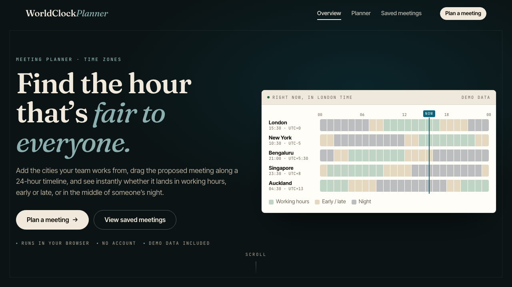
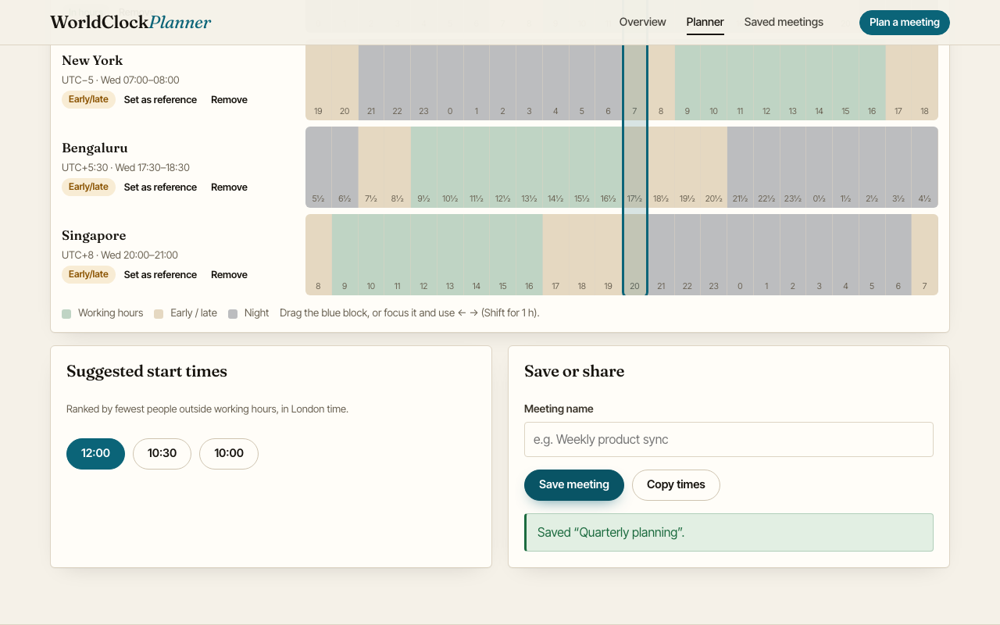
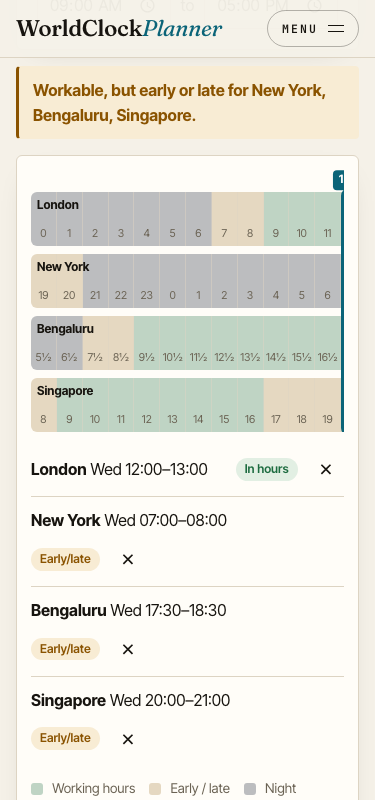

# WorldClock Planner

Plan a meeting across time zones. Add the cities attending, drag the proposed meeting along a 24-hour timeline, and see whether it falls inside working hours, early/late, or overnight for each person.





| Mobile | Landing |
| --- | --- |
|  |  |

## Run it

```bash
npm install
npm run dev        # http://localhost:5105
npm test
npm run build
npm run test:e2e   # Playwright smoke test (npm run e2e:install once if Chromium is missing)
```

## Main workflow

1. **Planner** → search for a city (43 built in) and add up to eight. The first is the reference city for the timeline; any city can be promoted with **Set as reference**.
2. Choose the date and duration. Optionally change working hours (applies to everyone).
3. Drag the blue meeting block on the timeline, or focus it and use ←/→ (15 min), Shift+←/→ (1 h), Home/End.
4. Read the verdict: *Works for everyone*, *Workable* (early/late or weekend somewhere), or *Unreasonable* (overnight somewhere). Each city shows its local time, UTC offset, next/previous-day and weekend flags.
5. Click a **suggested start time**, then **Save meeting** or **Copy times** for an invite.

Demo content: the planner opens with a four-city demo team (London, New York, Bengaluru, Singapore) and three labelled saved meetings, including one that is unreasonable for someone. Remove the cities to see the empty state, which offers **Load demo team (4 cities)**.

## Design

Shared editorial system (Fraunces display, Inter Tight UI, mono labels, ink hero, paper workspace). The hero preview is a live, real-time rendering of five cities’ working-hour bands with a “Now” marker, using the same time-zone code as the planner. Motion is limited to staggered entrances, row reveals and route cross-fades, all disabled under `prefers-reduced-motion`.

## How it works

- Offsets come from the browser's `Intl.DateTimeFormat` time zone database, evaluated at the chosen date, so daylight-saving changes are handled. No external API is called.
- “Early/late” = up to 2 hours before the working day starts or 4 hours after it ends; anything else outside working hours is “Overnight”.
- Suggestions scan the reference day in 30-minute steps and rank by a penalty (overnight 10, early/late 1, weekend 3), preferring times near midday on ties.

## Tests

- `src/lib/tz.test.ts` — offsets for fixed, half-hour (+5:30), 45-minute (+5:45) and DST zones; local-midnight conversion; classification; a London/New York/Tokyo meeting; next-day and weekend flags; suggestion quality; city lookup.
- `src/App.test.tsx` — empty state, unknown and duplicate city validation, keyboard movement of the meeting slider, save validation/success, applying a suggestion.
- `e2e/smoke.spec.ts` — real pointer drags on the timeline in Chromium, suggestion, save, saved list, and 375px layout.

## Limitations

- City list is fixed (43 cities); there is no free-text time zone entry.
- Working hours are shared by all cities; per-person hours are not supported.
- Public holidays are not considered.
- Meetings cannot cross the end of the reference city's day.

## Future improvements

- Per-person working hours and names (not just cities).
- ICS export with the meeting in UTC.
- Holiday awareness using a bundled holiday dataset.
